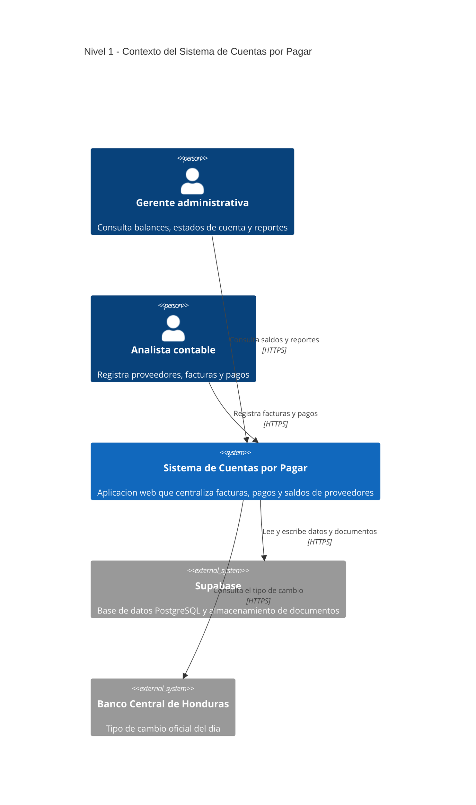
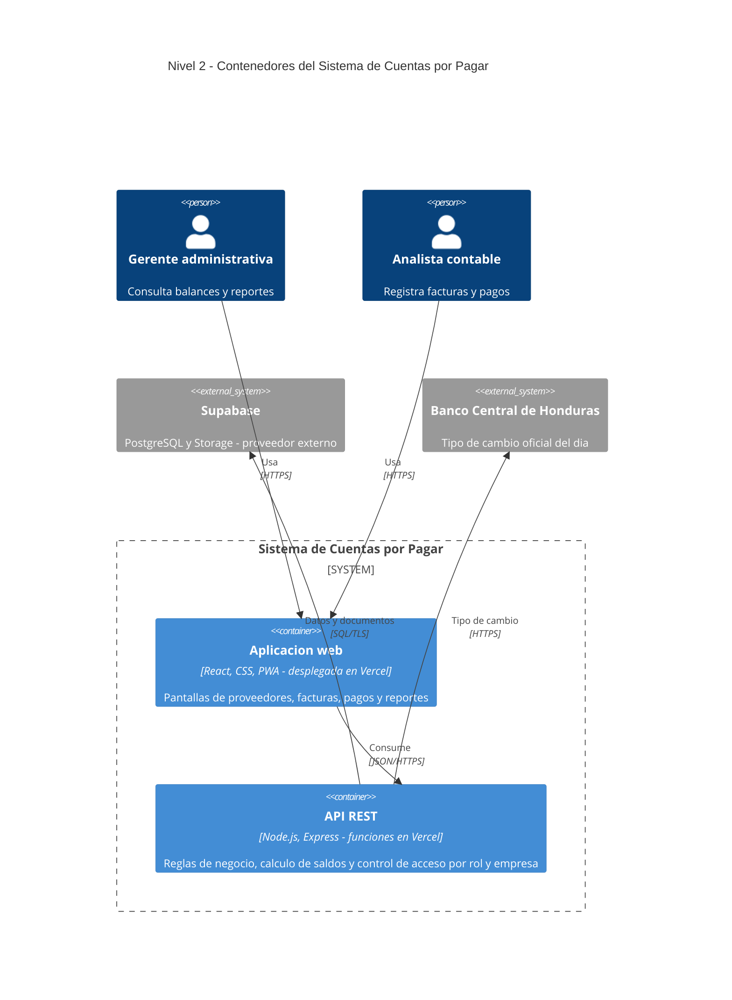

# Arquitectura — Sistema de Gestión de Cuentas por Pagar

> Práctica 6 · Diagrama C4 (niveles 1 y 2)
> Código de verificación: `LEARN-CAP-1DDC923F`

Sistema web para el área administrativa de una empresa de telecomunicaciones.
Centraliza facturas de proveedores, pagos, saldos y reportes, reemplazando el
control que hoy se lleva en hojas de Excel.

**Alcance de estos diagramas:** describen el sistema **diseñado**, no solo lo ya
construido. A la fecha están implementadas la base de datos y la API base; la
aplicación web en React y el almacenamiento de documentos están definidos pero
en desarrollo.

**Sobre el despliegue:** durante el curso el sistema se publica en Vercel. Al
finalizar, se trasladará al dominio propio de la empresa.

---

## Nivel 1 — Contexto

Quiénes usan el sistema y con qué sistemas externos se comunica.

### Decisiones de este nivel

**1. PostgreSQL gestionado en Supabase en lugar de SQL Server.**
Priorizo la **mantenibilidad** y la **seguridad** por encima de la familiaridad
del equipo con SQL Server. El sistema se despliega en Vercel, que no aloja SQL
Server, de modo que ese motor obligaría a contratar y conectar un servicio
aparte. Supabase cubre con una sola plataforma la base de datos y el
almacenamiento privado de los documentos, y permite políticas de acceso por
fila para aislar la información de las dos empresas. Sacrifiqué la experiencia
previa en SQL Server y el tiempo de aprender las diferencias de PostgreSQL.

**2. El tipo de cambio se congela en cada documento, no se guarda en una tabla
central.** Priorizo la **integridad del histórico** por encima de la
simplicidad. La clienta pidió expresamente que el tipo de cambio del Banco
Central "no altere el histórico", por lo que cada factura y cada pago conservan
la tasa vigente el día en que se registraron, autocompletada y editable. Cuesta
un campo repetido en dos tablas; a cambio, un estado de cuenta impreso hoy
sigue cuadrando dentro de un año.

---

## Nivel 2 — Contenedores

Las piezas que componen el sistema y la tecnología de cada una. Supabase queda
fuera de la frontera porque es un proveedor externo del que el sistema depende:
sus límites de servicio y sus pausas por inactividad no están bajo nuestro
control.

Los documentos de las facturas no se guardan en la base ni en una dirección
pública: viven en un bucket privado y la API genera enlaces firmados temporales
para quien tenga sesión activa.

### Decisiones de este nivel

**1. La aplicación web no se comunica con la base de datos: todo pasa por la
API.** Priorizo la **seguridad** por encima del rendimiento y de la simplicidad.
Si el navegador consultara la base directamente, las reglas de negocio vivirían
en el frontend, donde cualquiera puede saltárselas. Con la API en medio, una
validación como que la suma aplicada de un cheque no exceda su monto se cumple
siempre. Cuesta un salto de red más en cada consulta; a cambio, las reglas no
se pueden evadir.

**2. Los contenedores no dependen de funciones propias de Vercel.**
Priorizo la **portabilidad** por encima de la comodidad del despliegue. Vercel
es el alojamiento durante el curso, pero al finalizar el sistema se trasladará
al dominio propio de la empresa. Por eso la API es una aplicación Express común
y el frontend es una aplicación web estándar: ambos pueden ejecutarse en otro
alojamiento sin reescribirse. Sacrifiqué algunas facilidades que ofrece la
plataforma y gané que la mudanza no obligue a rehacer el sistema.

---

## Correcciones al borrador generado con IA

| Qué proponía la IA | Qué corregí y por qué |
|---|---|
| Afirmaba que la empresa no tiene personal de TI y justificaba Supabase con ese argumento. | La empresa **sí** cuenta con servicio de TI. Reescribí la justificación con las razones reales: Vercel no aloja SQL Server, y Supabase cubre base de datos y almacenamiento de documentos en una sola plataforma. |
| Ubicaba Supabase como sistema externo en el nivel 1, pero dentro de la frontera del sistema en el nivel 2. | Los dos diagramas se contradecían. Lo dejé **fuera** en ambos: es un proveedor del que dependemos, con límites de servicio y pausas por inactividad que no controlamos. |
| No mencionaba Vercel en ningún diagrama. | Agregué el alojamiento en la tecnología de cada contenedor, y una decisión sobre portabilidad: el sistema se trasladará al dominio de la empresa al terminar el curso. |
| No aclaraba si los diagramas muestran lo construido o lo diseñado. | Agregué una nota de alcance: describen el sistema diseñado; la base de datos y la API base ya están implementadas. |
| Incluía al Banco Central de Honduras como sistema externo. | **Verificado y conservado.** Lo contrasté con el correo a la clienta: el tipo de cambio se autocompleta tomando como referencia el del BCH, y ella lo confirmó. |